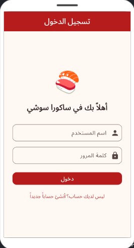
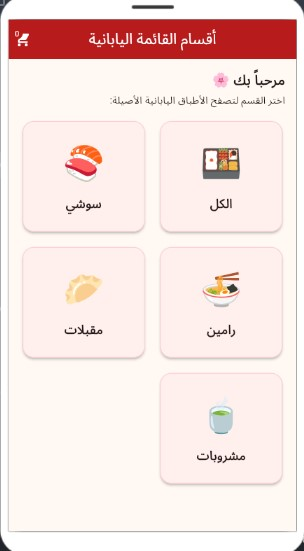

# ساكورا سوشي | Sakura Sushi

**اسم الطالبة / Student Name:** [سمر محمد الشهري]

---

## العربية

### فكرة التطبيق وشاشاته
تطبيق قائمة مطعم ياباني بتصميم مستوحى من الثقافة اليابانية، يتيح للمستخدم تصفح الأطباق وطلبها بسهولة.

**شاشات التطبيق:**
1. **الشاشة الافتتاحية (Splash Screen):** تعرض شعار واسم التطبيق واسم الطالبة مع حركة انتقال (Animation) وزر للانتقال إلى التسجيل.
2. **تسجيل الدخول وإنشاء حساب (Login & Register):** حفظ بيانات الحسابات في الذاكرة (`Map`) مع رسائل خطأ واضحة للحقول الفارغة، الحسابات المكررة، والبيانات غير الصحيحة.
3. **شاشة الأقسام (Categories):** عرض أقسام المطعم (الكل، سوشي، رامين، مقبلات، مشروبات).
4. **شاشة الأصناف (Menu Items):** عرض الأطباق حسب القسم المختار.
5. **شاشة تفاصيل الصنف (Item Details):** عرض أيقونة الطبق، اسمه، سعره، ووصفه الكامل مع زر الإضافة للسلة.
6. **شاشة السلة (Cart):** عرض الأطباق المضافة وحساب المبلغ الإجمالي.
7. **شاشة ملخص الطلب (Order Summary):** تأكيد الطلب وعرض عدد الأصناف والمبلغ النهائي.

### الميزة الإضافية وطريقة عملها
- **البحث والتصفية حسب التصنيف:** شريط بحث فوري مع أزرار تصفية (`ChoiceChip`) في شاشة الأصناف للوصول السريع للأطباق.
- **رسالة تأكيد قبل الحذف:** نافذة تنبيه (`AlertDialog`) تظهر عند محاولة حذف صنف من السلة لمنع الحذف بالخطأ.
- **حركة انتقال (Animation):** تأثير ظهور تدريجي (`FadeTransition`) في الشاشة الافتتاحية.

---

## English

### App Idea & Screens
A Japanese restaurant menu app with a Japanese-inspired visual identity, allowing users to browse dishes and place orders.

**Screens:**
1. **Splash Screen:** Displays the app name and student name with a fade animation and a button to proceed to login.
2. **Login & Register:** In-memory authentication using a `Map` with clear validation messages for empty fields, duplicate usernames, and invalid credentials.
3. **Categories Screen:** Displays restaurant categories (All, Sushi, Ramen, Appetizers, Drinks).
4. **Menu Items Screen:** Displays dishes based on the selected category.
5. **Item Details Screen:** Shows item icon, name, price, full description, and Add to Cart button.
6. **Cart Screen:** Lists added items and calculates the total price.
7. **Order Summary Screen:** Confirms the order with total items and final amount.

### Extra Features
- **Search & Category Filter:** Real-time search bar and category filter chips in the Menu Items screen.
- **Delete Confirmation Dialog:** An `AlertDialog` asks for confirmation before removing an item from the cart.
- **Animation:** Smooth `FadeTransition` on the Splash Screen. 

---

## Screenshots

## Demo Video
[اضغطي هنا لمشاهدة فيديو تشغيل التطبيق على Google Drive](https://docs.google.com/videos/d/1PlZB6FjiiIL9X-AvJFQjFG59BTAVFDNX2q41qs-f1JI/play?usp=sharing)
